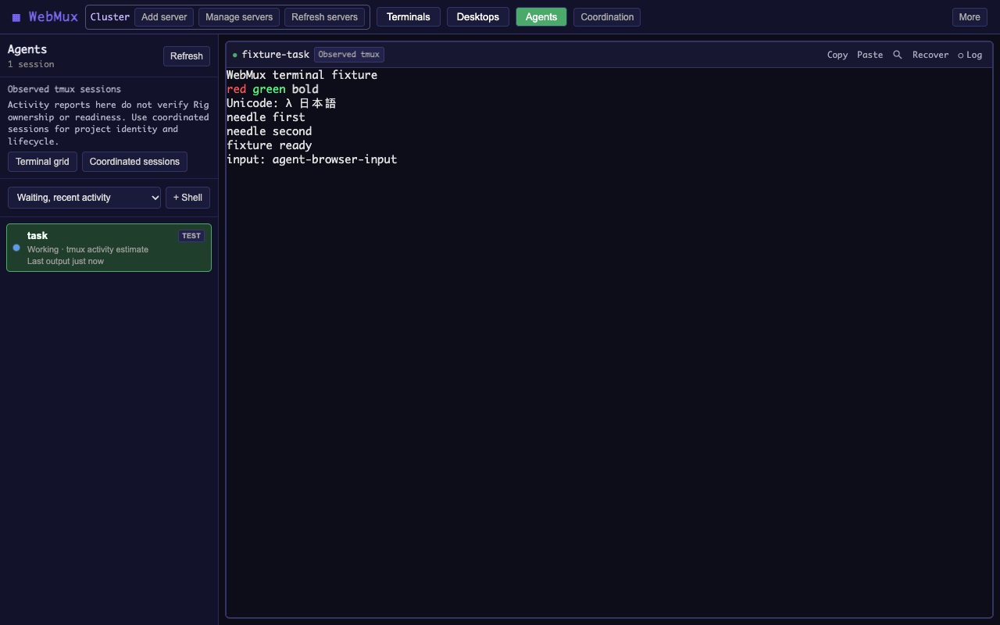

# Optional Agents-pane provenance — 2026-11-17

This candidate addresses #434, the optional Agents-pane reconciliation portion
of #194. The pane explicitly labels its attached terminals **Observed tmux**,
distinguishes **Scratch shell**, and shows the existing activity source as a
hook report, WebMux report, tmux activity estimate or unknown source. Configured
runtime badges identify the socket group. They do not establish Rig ownership
or provider readiness. Sorting labels now describe waiting/activity reports.

Direct controls lead to the terminal grid and, for administrators with access,
coordinated sessions. Navigation preserves the existing viewer and process.
Discovery, provider launch, adoption and lifecycle behavior are unchanged.

The final native macOS ARM64 check passes with Node24.21.0, tmux3.8,
Chrome157.0.8103.79 and published Rig0.6.14 (`df1c1517`). The app inherits an
unrelated CLI host selection while its own Rig inventory remains reachable.
A separate private socket contains an observed synthetic Node terminal.
The check proves real keyboard input, same viewer after reload, navigation to
Coordination and the grid, the same native PID, exactly one tmux session, no
inferred Rig identity, and scratch-shell creation/close. Fixture daemon/socket
cleanup and observed-provider exit were verified after the run. Native elapsed
time:14.4 seconds, one passed, no failures or skips.

All376 frontend tests across39 files, strict TypeScript/source coverage,
frontend lint/build, workflow YAML parsing and whitespace checks pass.
[native-results.json](native-results.json) records source, native receipt,
screenshot and private-log hashes. The 1280x800 native screenshot was inspected
for readable provenance, controls and terminal content:

This result does not establish authenticated coding-provider workloads, stable
canonical Rig identity across lifecycle changes, or automatic adoption. Those
remaining #194/#318 requirements stay open. Exact-head hosted gates are required;
[#429](https://github.com/jordanhubbard/webmux/issues/429) still blocks merge and
release. Production audit and rate-limit gates are preserved.
